  

  

<!-- [**ABOUT ME**](#-about-me) · [**FEATURED PROJECTS**](#-featured-projects) · [**TECH STACKS**](#-tech-stacks) · [**ACTIVITY**](#-activity) -->

## ✦ ABOUT ME

    Once upon a time (well, currently), a <b>Computer Science student</b> set off on a quest to make sense of <b>Artificial Intelligence</b> and <b>Machine Learning</b>. But deep down, I never really stopped being a <i>Disney kid</i>, the kind who grew up truly believing magic was real ✨, and that belief never quite faded. I’m utterly enchanted by the beauty of far-off lands, especially <i>Europe, Australia, and North America</i> 🌍, exploring their wonder mostly through blogs, vlogs, and movies. And somehow, that same <i>“anything’s possible”</i> spirit always finds its way into every project I build, because it turns out even code needs a little <b>pixie dust</b> and imagination to truly come to life 🪄

    There are <i>quieter chapters</i>  behind that love of magic. I live with <b>major depressive disorder</b>, and there have been times when sleep was difficult, my body felt exhausted, and the things I usually enjoyed seemed far away. I could still look like myself to other people while struggling to answer a message or follow through on a plan. Sometimes, I buried myself in work because staying busy felt easier than explaining why I was pulling away from people I cared about. I had returned to a psychiatrist for help, but <i>finding the words to tell my friends</i> was its own difficult step 🌙

  In one of those chapters, <b>one of my close friends gave me room to speak</b>. What began as an ordinary late-night conversation became a chance to share things I had been keeping to myself. She listened, asked questions, and offered a choice I appreciated: <i>whether I wanted her to respond or simply hear me out.</i> I could talk without having to turn everything into a clear explanation. And in the days that followed, she kept including me in the ordinary plans I was so often tempted to avoid 🤍

  One of those moments stayed with me. I was about to cancel an outing and had started writing the message. When I opened our conversation, <i>I remembered her encouragement</i>. I was still overthinking; leaving the house still felt difficult. For a while, I went back and forth in my head. <b>Then I deleted the draft and went.</b> Later, I thanked her, a little awkwardly, because something she had said in a conversation had helped me make a decision that felt much harder than it probably looked 🌱

  There is more to living with depression than I can fit into a few paragraphs, and that evening did not resolve everything I was facing. But I want this part of my story to have a place here, too: a friend who made room for what I was carrying, <b>a message I never sent, and an evening I almost missed</b>. <i>Alongside my love of imagined worlds, I am grateful for moments like that in this one.</i> 

 

> ✧ **A few things that keep me curious** 
> Artificial intelligence & machine learning · Stories that spark imagination · The beauty of far-off places
 

## ✦ TECH STACKS

  

<table>
  <tr>
    <td width="50%" valign="top">
      

        <b>Blockchain</b>
      

      

        
        
        
        
        
        
        
        
      

    </td>
    <td width="50%" valign="top">
      

        <b>Cybersecurity</b>
      

      

        
        
        
        
        
        
        
        
      

    </td>
  </tr>
  <tr>
    <td width="50%" valign="top">
      

        <b>Back-End</b>
      

      

        
        
        
        
        
        
        
        
        
        
        
        
        
      

    </td>
    <td width="50%" valign="top">
      

        <b>AI &amp; Machine Learning</b>
      

      

        
        
        
        
        
        
        
        
        
        
      

    </td>
  </tr>
  <tr>
    <td colspan="2" valign="top">
      

        <b>Web, Mobile &amp; Interactive Foundations</b>
      

      

        
        
        
        
        
        
      

    </td>
  </tr>
</table>

## Frameworks

  

<table>
  <tr>
    <td width="50%" valign="top">
      

        <b>Web &amp; Fullstack</b>
      

      

        
        
        
        
        
        
        
        
        
        
      

    </td>
    <td width="50%" valign="top">
      

        <b>Back-End &amp; API</b>
      

      

        
        
        
        
        
        
      

    </td>
  </tr>
  <tr>
    <td width="50%" valign="top">
      

        <b>Front-End &amp; Reactive UI</b>
      

      

        
        
        
        
        
      

    </td>
    <td width="50%" valign="top">
      

        <b>Desktop Application &amp; GUI</b>
      

      

        
        
        
      

    </td>
  </tr>
  <tr>
    <td width="50%" valign="top">
      

        <b>AI &amp; Agentic</b>
      

      

        
        
        
      

    </td>
    <td width="50%" valign="top">
      

        <b>ORM / Data Access</b>
      

      

        
      

    </td>
  </tr>
  <tr>
    <td width="50%" valign="top">
      

        <b>CSS / Styling</b>
      

      

        
      

    </td>
    <td width="50%" valign="top">
      

        <b>3D &amp; Real-Time Interactive Engine</b>
      

      

        
      

    </td>
  </tr>
</table>

 

 

## ✦ ACTIVITY

---

  A curious mind. A little pixie dust. A story still unfolding. ✧

